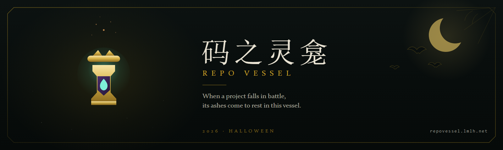

<p align="center">
  
</p>

<h1 align="center">码之灵龛 / Repo Vessel</h1>

<p align="center">
  <a href="https://github.com/limccn/repo-vessel/actions/workflows/ci.yml"></a>
  <a href="LICENSE"></a>
  
  
  
  
</p>

<p align="center">
  <a href="https://deploy.workers.cloudflare.com/?url=https://github.com/limccn/repo-vessel"></a>
</p>

A public-repository discovery site. Type a GitHub username and get a **灵龛鉴定** — a reading of which of their public repositories have gone dormant, and where their forks originally came from. Owners can claim a repository to hide it from the boards, and anyone can file a takedown request without signing in.

> **中文摘要** —— 输入一个 GitHub 用户名，看看哪些公开仓库已经沉睡、Fork 从哪里来；也可以给自己的公开仓库加上本站主题，等它入龛。全站只读：不读取仓库里的任何代码，不归档、不删除、不修改任何仓库。仓库主人认领之后可以随时隐藏，没有 GitHub 账号也能提交下架申请。

The name is a Dota 2 flourish: an urn that fills with the fallen. It is a metaphor, not a verdict — a quiet repository is described as quiet, never as dead, failed, or abandoned.

## What it does

- **Dormancy reading** — for any personal GitHub account: public owned repositories only, sorted by last push, with derived tags, a title, and representative repositories.
- **Fork provenance** — resolves where each fork came from (`parent`), up to 25 forks, and says *unresolved* when it genuinely cannot tell.
- **Leaderboards** — three boards built from a six-hourly cron sweep of repositories carrying the site's topic: `longest-sleep`, `embers`, `forks`. Top 50, D1-only reads, zero upstream calls at request time.
- **Share cards** — a 1080×1440 canvas card in the browser, and a 1200×630 OG image rendered server-side (resvg + pinned Noto subsets) for link previews.
- **Achievements** — two badges awarded at 10 and 25 topic-carrying public repositories, derived from the current count, never stored.
- **Owner control** — sign in with GitHub (`read:user` scope only) to claim a repository and hide or restore it; an anonymous takedown ticket exists for everyone else.
- **Four languages** — English, 简体中文, 繁體中文, 日本語. Detection is browser-first; a signed-in visitor can pin one in `/manage`.

## What it never does

These are product boundaries, not disclaimers. They are enforced in code and covered by tests.

- **No writes to GitHub.** The site never archives, deletes, syncs, renames, or modifies a repository. OAuth asks for `read:user` and nothing else.
- **No private repositories, no organisation accounts.** Only public repositories a personal account owns; collaborator-only access does not count.
- **No repository content.** Metadata only — last push, stars, forks, language. No file trees, no README bodies, no secret or CVE scanning.
- **No inferred conclusions.** Facts, not verdicts: not "dead upstream", not "your work was never merged", not "this project failed".
- **Unknown is not zero.** A rate limit, a timeout, or a truncated read is shown as unknown or incomplete — never as `0`, and never as an empty list.
- **No auto-publishing.** Share cards are opened by you and sent by you; nothing is posted anywhere, and no one is ever @-mentioned.
- **No user database.** The session is a stateless HMAC-signed cookie; analytics are anonymous daily counters with no IP, user agent, or identifier column.

## Quick start

Requires Node ≥ 20.19.

```bash
npm install

# Local stack: D1 + Worker + built assets on http://localhost:8787
npm run build
npx wrangler d1 migrations apply repo-vessel --local
npx wrangler dev --port 8787

# SPA only, with hot reload (no /api — the worker serves the API)
npm run dev
```

The worker reads secrets from `.dev.vars` (gitignored; see `.dev.vars.example`).

Checks — the same six gates CI runs:

```bash
npm run typecheck && npm run lint && npm run test
npm run build && npm run audit:design && npm run audit:og-font
```

`audit:design` fails the build on a hand-written colour, duration, or easing outside `tokens.css`, or on a foreground colour below 4.5:1. `audit:og-font` fails when a share-card glyph is missing from a font subset — the one failure no compiler can see.

## Environment variables

| Variable | Kind | Purpose | Default |
|---|---|---|---|
| `REPO_TOPICS` | Worker var | Comma-separated topics. A repository carrying **any** of them is enrolled. | `repo-vessel,urn-of-repos` |
| `VITE_REPO_TOPICS` | Build-time | The same list for the SPA. Both sides resolve it through `src/shared/topic.ts`. | `repo-vessel,urn-of-repos` |
| `GITHUB_CLIENT_ID` | Worker var | OAuth app client id (public). | — |
| `GITHUB_CLIENT_SECRET` | **Secret** | OAuth token exchange. | — |
| `SESSION_SECRET` | **Secret** | HMAC key that signs the session cookie. Missing → every login fails closed. | — |
| `GITHUB_API_TOKEN` | **Secret** | Classic PAT with **zero scopes**, used only for server-side `api.github.com` reads (5 000 req/h). | — |
| `OAUTH_REDIRECT_URI` | Optional var | Callback override. | `<origin>/api/auth/callback` |
| `VITE_SITE_URL` | Build-time | Absolute base for `og:url` / `og:image`. | `https://repovessel.lmlh.net` |
| `VITE_TWITTER_HANDLE` | Build-time | Footer Twitter / X link. | `limccn` |
| `VITE_GITHUB_REPO_URL` | Build-time | Footer repository link. | this repository |

A fine-grained PAT cannot read arbitrary users' public repositories, and `public_repo` carries write permission — neither is acceptable. Only a classic zero-scope PAT is.

## Deploy

The **Deploy to Cloudflare** button above provisions the Worker and a D1 database, builds from your fork, and publishes to `<worker>.<subdomain>.workers.dev`. The committed `wrangler.jsonc` deliberately carries no `routes` — a custom domain the deployer does not own makes `wrangler deploy` fail, which would break one-click deployment. To serve your own domain afterwards, add it to `routes` and set `workers_dev: false`.

Three things the button cannot do for you:

```bash
# 1. Secrets — the site starts fails-closed until these exist
npx wrangler secret put GITHUB_CLIENT_SECRET
npx wrangler secret put SESSION_SECRET
npx wrangler secret put GITHUB_API_TOKEN

# 2. Schema — migrations first; a missing table degrades to `failed` boards
npx wrangler d1 migrations apply repo-vessel --remote
```

3. **Point the site at itself.** Set `GITHUB_CLIENT_ID` to your OAuth App's client id, register `https://<your-domain>/api/auth/callback` as its callback URL, and build with `VITE_SITE_URL=https://<your-domain>` — otherwise `og:image` still points at this deployment's domain. `REPO_TOPICS` can stay on the default, or name topics of your own.

The cron (`17 */6 * * *`) registers with the Worker and starts filling the collection tables on its own. Operator commands — cron inspection, takedown handling, D1 backups — are in [`docs/runbook.md`](docs/runbook.md).

## Project structure

| Path | What lives there |
|---|---|
| `src/frontend/` | The SPA — routes, layouts, components, `tokens.css` (the only hand-written colour source), client-side share card |
| `src/shared/` | Wire contract, thresholds, tier derivation, topic resolver, formatters, i18n model + dictionaries, generated token mirror |
| `src/worker/` | The Cloudflare Worker — OAuth, read endpoints, share images, boards, claims, takedowns, metrics beacon, cron |
| `src/worker/collect/` | The cron sweep: discovery, budgeted verification, resumable cursor |
| `src/worker/db/` | D1 access for the site's own tables |
| `src/worker/share/` | Server-rendered OG card: hand-written SVG, resvg, six pinned font subsets |
| `migrations/` | D1 schema — `repo_cache`, the collection tables, `metrics_daily` |
| `docs/` | Product specs and operations: interaction PRD, visual system, metrics contract, runbook |
| `scripts/` | Build and audit scripts: tokens, OG vocabulary, font subsets, metrics report |
| `prompt/` | The design revision chain (v1 → v4.1) and a competitor analysis, kept as a public archive |

## Internationalization

Four locales ship: `en` (default), `zh-Hans`, `zh-Hant`, `ja`. There is no key namespace — **the Simplified-Chinese sentence is the msgid**, and `src/shared/i18n-dictionaries.ts` holds only the other three languages. A missing entry falls back to Chinese, never to English.

The SPA sends `x-rv-locale`; payload prose (titles, board descriptions, plain-text errors) is localized server-side, and caches are keyed per locale. Share images use three static font pairs because resvg cannot pick fallbacks — `npm run og-vocabulary && npm run og-font` regenerates them after copy changes, and `audit:og-font` catches the rest.

## Measurement and privacy

`docs/metrics.md` is the normative contract. In short: day × event × dim is one row — the table never grows with visitors, and no row can be resolved to a person. The `dim` charset cannot carry a username, repository name, or URL. Do Not Track and Global Privacy Control are respected — those visitors send nothing, and every failure is silent. The report (`npm run metrics`) distinguishes *not collected* from a real zero and flags windows under 100 events.

## License

[MIT](LICENSE). The generated OG font subsets derive from Noto Sans SC / TC / JP (OFL-1.1); `@resvg/resvg-wasm` is MPL-2.0, used unmodified.

## Acknowledgements

- Thanks to [**@liguobao**](https://github.com/liguobao) for the encouragement and the conversations this project grew out of.
- Inspired by [**VibeCemetery**](https://vibecoding.dev/) — the idea that abandoned side projects deserve a considered resting place rather than a shrug.
- The Dota 2 register (灵龛, 灰烬, 入龛) is borrowed as flavour; this project is not affiliated with or endorsed by Valve.
